# BL62 Reconstruction GUI — User Manual

English edition: October 26, 2026

Application release: 1.0.1

Released source commit 0ddce1e: accurate analysis phases, elapsed time, segmentation timings and search-range curve zoom.

## 1. Purpose and Interface

BL62 Reconstruction provides manual tomography/laminography reconstruction and a separate Intelligent Data Analysis (Test) workflow for automatic tomography rotation-center search.

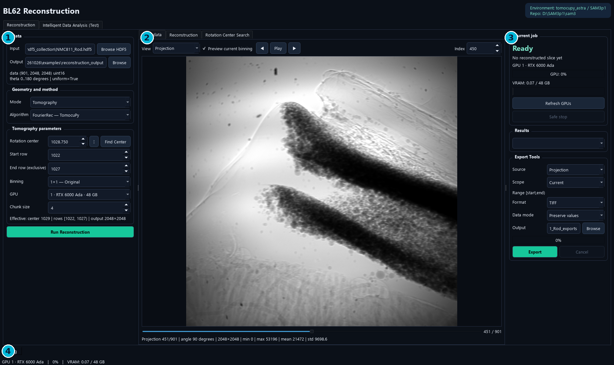

- Reconstruction retains the original three-column manual workflow.
- Intelligent Data Analysis (Test) searches the center, reconstructs data and optionally segments every reconstructed slice.
- The latest progress text distinguishes center search, reconstruction, segmentation and final report saving.

## 2. Windows Installation and Environments

1. Install an NVIDIA driver and Miniforge on the target Windows computer.
2. Run BL62_Reconstruction_GUI_Setup_1.0.1.exe, or extract the entire portable ZIP.
3. Use Install Environments to prepare the isolated native Windows runtimes.
4. Launch BL62 Reconstruction and check Environment / Repo in the header.
5. For automatic analysis, verify Settings → SAM3 paths and checkpoint.

| Component | Current runtime |
| --- | --- |
| GUI EXE | Bundled Qt/display dependencies |
| Reconstruction backend | tomocupy_astra; native Windows Python 3.10 |
| SAM3 inference backend | SAM3p1; native Windows Python 3.12 |
| SAM3 source | D:\SAM3p1\sam3 preferred; tested source also supplied with the release |
| Checkpoint | D:\Chcekpoints\checkpoint_demo_05142026.pt by default |

**Note.** This reconstruction release does not require WSL. GPU drivers, Conda and model weights are external. Environment creation downloads several GB; copying only the EXE is not a complete portable installation.

## 3. Input HDF5 and Data Checks

1. In Reconstruction, click Browse HDF5 and select the input .h5 or .hdf5 file.
2. Read the dimensions, stored dtype and angle information under Data.
3. Inspect a representative projection and the flat/dark images before reconstruction.
4. Choose an output parent folder and begin with a small detector-row range.

| Required HDF5 dataset | Meaning |
| --- | --- |
| /exchange/data | 3D projection stack: projections × detector rows × detector columns |
| /exchange/data_white | Flat-field images |
| /exchange/data_dark | Dark-field images |
| /exchange/theta | One finite angle per projection |

**Note.** The GUI checks required datasets and angle count/finite values. It identifies degree/radian units from stored values and reports angle uniformity. A detector midpoint is an initial suggestion, not a validated rotation center for every specimen.

## 4. Inspect Input Images

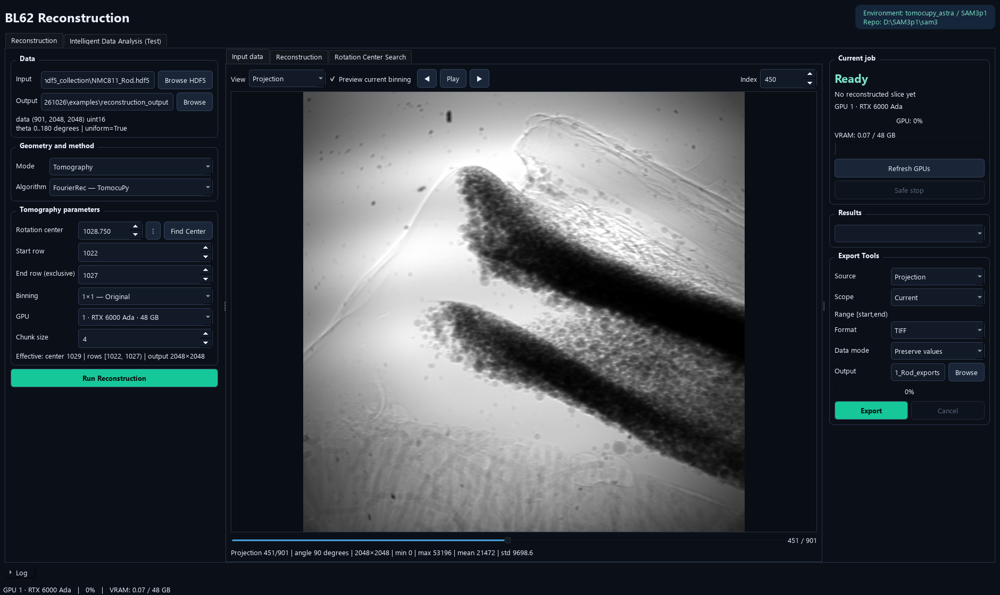

1. Choose View: Projection, Flat, Dark, Flat/Dark Corrected or -Log Attenuation.
2. Use arrows, slider or Index to inspect individual frames; Play advances frames.
3. Use Preview current binning to view the reduced preview associated with the selected binning.
4. Read frame position, angle and intensity statistics below the image.

**Note.** Frame Index is a zero-based projection/flat/dark frame index. It is different from Start/End Row, which select detector rows for reconstructed slices. Preview contrast is not a change to source intensities.

## 5. Reconstruction Parameters

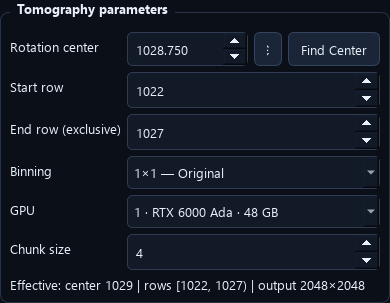

| Parameter | Meaning |
| --- | --- |
| Rotation center | Axis position in original detector-pixel coordinates |
| Start row / End row (exclusive) | Original detector rows in [start, end) |
| Binning | 1×1, 2×2, 4×4 or 8×8; backend adapts effective geometry |
| GPU | Physical NVIDIA device for this job |
| Chunk size | Rows handled in a backend batch; affects memory/performance |
| Iterations | Used by SIRT_CUDA and CGLS_CUDA |

**Note.** Rows 0–2048 means 2048 rows, numbered 0 through 2047. Keep center/row entries in original coordinates; do not manually divide the center again when choosing binning. Check Effective geometry below the parameters.

## 6. Choose a Tomography Method

- Compare methods with the same source, center, row range and binning.
- Use a few central rows to confirm a finite and visually plausible reconstruction before a full run.
- LpRec uses a lightweight external-link HDF5 view with uniform angles; the original HDF5 is preserved.
- Laminography offers its own supported method list; it is not the same geometry as parallel-beam tomography.

| Method | Practical description | Important condition |
| --- | --- | --- |
| FourierRec | Fourier-based TomocuPy reconstruction | Analytic; no iteration count |
| LpRec | Log-polar TomocuPy reconstruction | Uses a uniform-angle approximation view |
| LineRec | Direct line/backprojection TomocuPy reconstruction | Analytic; often more computational work |
| FBP_CUDA | ASTRA filtered backprojection | Analytic GPU baseline |
| SIRT_CUDA | ASTRA iterative reconstruction | Iteration count affects result and runtime |
| CGLS_CUDA | ASTRA iterative least-squares reconstruction | Iteration count affects result and runtime |

**Note.** An algorithm choice is not a guarantee of image quality. Angle coverage, calibration, center and acquisition geometry remain important.

## 7. Manual Find Center

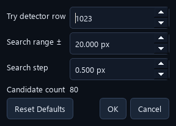

1. Enter an initial Rotation center estimate.
2. Open the adjacent gear and set Try detector row, Search range ± and Search step.
3. Confirm the settings and click Find Center.
4. Inspect candidates in the Rotation Center Search preview using its slider.
5. Click Apply Selected Center for the visually preferred candidate, then run the desired full reconstruction.

**Note.** This manual button reconstructs a user-defined sweep for visual selection. It does not perform SAM3 confidence scoring. With an ASTRA full-reconstruction method selected, the center sweep uses FourierRec and preserves the selected full-reconstruction method.

## 8. Laminography Mode

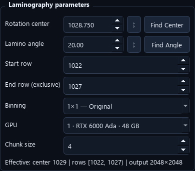

1. Choose Geometry and method → Mode → Laminography for a laminography acquisition.
2. Choose a supported laminography algorithm: FourierRec or LineRec.
3. Set Rotation center, Lamino angle and the desired row range.
4. Use a small reconstruction to verify geometry before scaling up.

**Note.** Mode changes enable/disable the relevant fields and methods automatically. Merely selecting Laminography does not make an ordinary tomography dataset a laminography measurement. Automatic Intelligent Data Analysis in this release estimates tomography center only.

## 9. Manual Find Angle

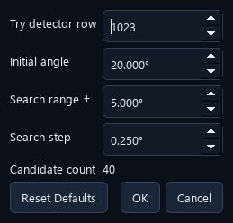

1. Select Laminography mode.
2. Open the gear beside Lamino angle and set the initial angle, range ± and angle step.
3. Click Find Angle. The manual sweep uses LineRec.
4. Compare reconstructed candidates in the search preview.
5. Apply the selected angle and reconstruct with the intended final settings.

**Note.** Find Angle is a manual visual sweep. There is no automatic SAM3-driven laminography-angle optimizer in the current release. Tomography mode disables this control.

## 10. Run, Stop and Inspect Reconstruction

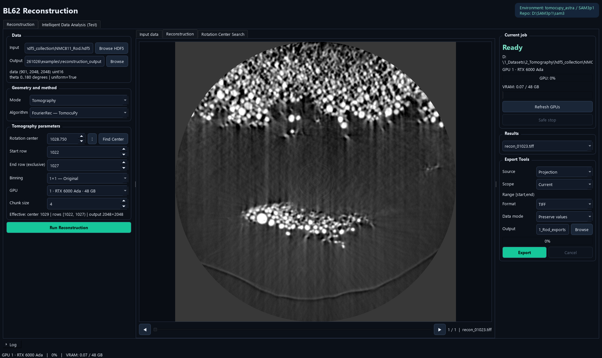

1. Confirm input, output parent, geometry/method, center, rows, binning and GPU.
2. Click Run Reconstruction; the application creates an isolated run directory.
3. Inspect output slices as they become available in Reconstruction and Results.
4. Use result arrows/slider to move through available slices.
5. Use Safe stop to stop this job if needed, then wait for its backend to exit.

**Note.** The original input HDF5 is preserved. A stopped/failed job can leave partial outputs; do not treat those as a completed full volume. A successful small test should precede a full-volume run.

## 11. Export Images and Preserve Values

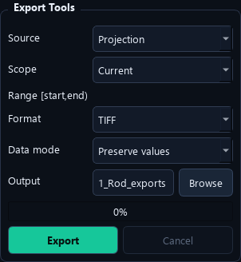

1. Choose Source: Projection, Flat, Dark, Corrected, -Log Attenuation or Reconstruction results.
2. Choose Scope: Current, Range or All; Range uses [start, end).
3. Choose TIFF or PNG and the desired Data mode.
4. Choose an output folder and click Export; Cancel stops the export worker.

| Data mode | Use |
| --- | --- |
| Preserve values / TIFF | Retain the data array values and dtype |
| Float32 / TIFF | Write numeric values as float32 |
| Display 8-bit / 16-bit | Map the 1–99 percentile range for viewing |
| PNG | Requires 8-bit or 16-bit display mapping; incompatible value modes are changed automatically |

**Note.** Display conversion changes exported viewing values. Use preserve-value TIFF for quantitative downstream processing. export_metadata.json records output dtype, dimensions and mapping.

## 12. Intelligent Data Analysis: Start

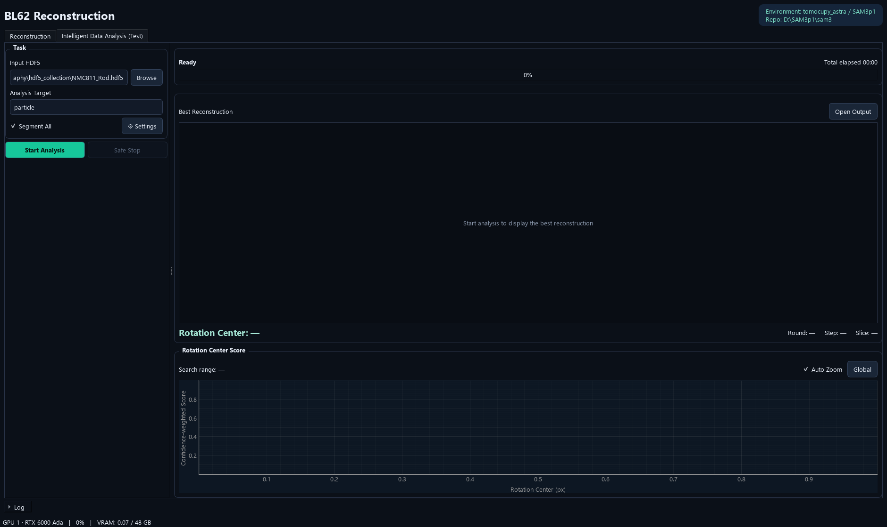

1. Open Intelligent Data Analysis (Test).
2. Browse to the HDF5 file and enter Analysis Target, for example particle.
3. Leave Segment All checked to segment every reconstructed output slice, or uncheck it for center search plus reconstruction only.
4. Use Settings only when defaults need changing.
5. Click Start Analysis and monitor the current phase.

**Note.** By default the application creates {input_name}_analysis_{timestamp} beside the HDF5 file. Automatic analysis is currently a tomography rotation-center workflow, followed by reconstruction and optional per-slice segmentation.

## 13. Analysis Settings: Reconstruction

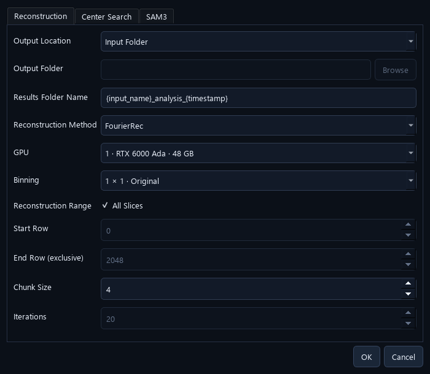

- Output Location selects Input Folder or a Custom Folder parent. Each run still gets a timestamped child directory.
- Reconstruction Method and GPU select the final reconstruction backend/device.
- All Slices uses the full detector-row extent; otherwise set Start Row and End Row (exclusive).
- Binning, Chunk Size and iterative-method Iterations control full reconstruction.
- All entered rows and center coordinates refer to the original detector geometry.

## 14. Analysis Settings: Center Search

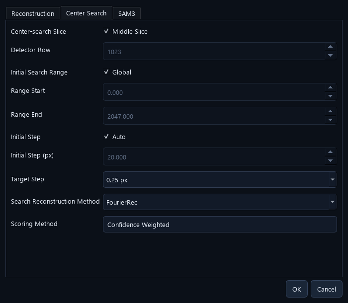

- Middle Slice uses detector row floor((height−1)/2); for a 2048-row detector this is row 1023.
- Global searches centers from 0 through detector width−1. Disable it to set a custom initial range.
- Auto initial step uses max(1, round(width/100)) pixels; a 2048-column detector starts at 20 px.
- Target Step defaults to 0.25 px; 0.5 px and 1 px are available.
- Search Reconstruction Method is separate from the final full-volume method.
- Scoring Method is Confidence Weighted in the current release.

**Note.** The target step is the search-grid resolution, not a guarantee of physical center accuracy to that many pixels.

## 15. Analysis Settings: SAM3

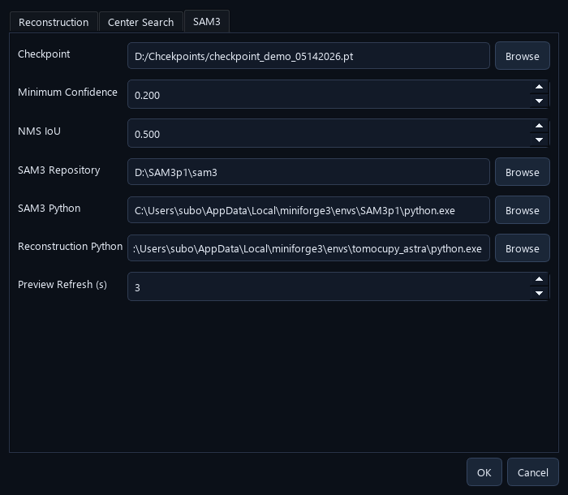

| Field | Current default / purpose |
| --- | --- |
| Checkpoint | Shared inference model at D:\Chcekpoints\checkpoint_demo_05142026.pt |
| Minimum Confidence | 0.20 |
| NMS IoU | 0.50; duplicate mask suppression |
| SAM3 Repository / Python | External native Windows SAM3 source and inference runtime |
| Reconstruction Python | External tomography reconstruction runtime |
| Preview Refresh | 3 seconds; updates best image and score view |

**Note.** One automatic job loads SAM3 once and reuses it for center candidates and optional full-data segmentation. The worker releases the model when the job exits. It is not a model shared with a separately running Label GUI.

## 16. Automatic Center Search: What Happens

1. Read the selected middle/custom detector row and build the initial center grid.
2. Reconstruct that same row at each new candidate center.
3. Normalize a viewing/inference copy and run SAM3 with the Analysis Target.
4. Remove duplicate masks using the configured mask-IoU threshold and compute the confidence-weighted score.
5. Combine all evaluated points from this and previous rounds; apply global Gaussian smoothing.
6. Choose supported peak neighborhoods, narrow/refine the search and reuse candidates already evaluated.
7. Repeat until the target step and peak-support checks are satisfied, then save the selected center.

**Note.** Only one detector row is evaluated during center search by default. Full-volume reconstruction happens afterward. Multiple supported peaks can be refined; an empty/flat score curve fails the estimate rather than silently reporting a reliable center.

## 17. Confidence-weighted Scoring

A more confidently recognized particle contributes more to the candidate-center score. The score uses SAM3 evidence, rather than a manual image-sharpness measurement.

- The table describes the current fixed 0.20–0.80 reward mapping.
- The inference confidence setting first determines which predictions are available; NMS removes duplicate masks.
- A larger score means stronger combined model evidence, not a percentage accuracy.
- Confirm the selected reconstruction visually. Different prompts/checkpoints can change the score curve and preferred center.

| Particle confidence | Contribution |
| --- | --- |
| 0.20 | 0 |
| 0.40 | 0.3333 |
| 0.60 | 0.6667 |
| 0.80 or higher | 1.0000 |

```text
For each retained particle with confidence p:
  reward = clip((p − 0.20) / 0.60, 0, 1)

Candidate score = sum of the retained-particle rewards
```

## 18. Global Filtering and Local Curve View

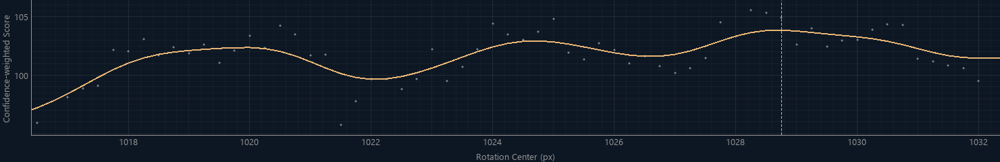

- Every round uses all previously evaluated points when calculating the smoothed score curve.
- Auto Zoom follows the current search interval and adjusts the visible score range.
- Global shows the full center range; turning Auto Zoom back on restores interval following.
- Raw points and the smoothed curve are separate plot elements. The selected-center marker identifies the displayed recommendation.

**Note.** Zooming changes display bounds only. It does not discard old samples or recompute filtering from only the visible points. Smoothing reduces isolated spikes but does not prove that a model-selected peak is the physically exact center.

## 19. Progress and Best Reconstruction

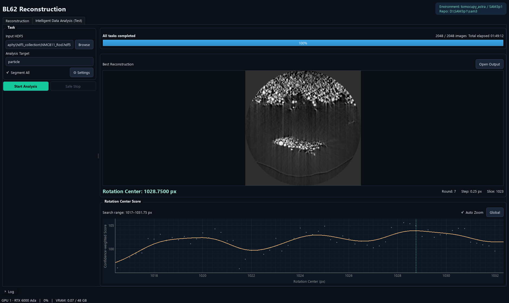

- During search, progress counts new centers in the current round. Adaptive later rounds can have different totals.
- The best image, Rotation Center, Round, Step and Slice belong to the same current status.
- The preview refresh interval defaults to three seconds, so it need not change after every candidate.
- Total elapsed includes center search, reconstruction, optional segmentation and final saving.

**Note.** A best-so-far image during search is provisional. All tasks completed indicates that all enabled phases and the final summary have finished. The example's center/time are dataset-specific, not defaults for other datasets.

## 20. Understand Each Progress Stage

| Display / phase | Current task |
| --- | --- |
| Preparing analysis | Validating/initializing this job |
| Stage 1: Reconstructing center candidates | Generating candidate images for the current round |
| Stage 1: Finding rotation center | SAM3 recognition, score computation and adaptive refinement |
| Stage 2: Reconstructing all data | Writing the requested reconstruction slices |
| Stage 3: Reconstruction completed — segmenting all data | Reconstruction is finished; SAM3/label generation/saving continues |
| Saving the final analysis report | Writing completion summaries |
| All tasks completed | All enabled phases have completed |
| Stopped / Failed | Partial results only; check Log |

**Note.** Without Segment All there are two numbered stages. An indeterminate bar means that phase has no useful fixed count. The current-stage bar is not an estimated whole-job percentage or remaining-time prediction.

## 21. Segment All: Results and Overlap

1. Keep Segment All enabled before Start Analysis when masks are needed for the full reconstruction.
2. After reconstruction completes, wait for each slice to be read, recognized, de-duplicated, labeled and saved.
3. Inspect label TIFFs and instances.csv under segmentation/.
4. Use the packed instance-mask NPZ when separate overlapping object masks are required.

| Output | Meaning |
| --- | --- |
| recon_XXXXX.tiff in segmentation/ | Integer instance-label image; 0 is background |
| recon_XXXXX_instances.npz | Packed independent masks, scores and image shape |
| instances.csv | Slice, local instance ID, confidence and original mask area |
| timings.csv / timing_summary.json | Per-step and aggregate segmentation timing |

**Note.** A label TIFF has one ID per pixel; the first retained mask wins at overlap pixels. NPZ preserves individual overlaps, so its mask area can exceed that instance's visible area in the label TIFF. IDs restart on each slice: Segment All does not perform 3D particle tracking.

## 22. Automatic Output Folder

- Open Output in the analysis preview opens the current run directory.
- The center-search summary is not proof that later reconstruction/segmentation has finished.
- For a successful full analysis, check analysis_summary.json and its reconstructed/segmented slice counts.
- Keep input HDF5, model identity and configuration with results for reproducibility.

```text
{input_name}_analysis_{timestamp}/
  analysis_job.json           # submitted GUI settings
  pipeline_config.json        # worker settings / input fingerprints
  status.json                 # live/final worker status
  analysis_summary.json       # final successful completion summary
  center_search/
    summary.json
    scores.csv
    history.json
    adaptive_search.png
    best_reconstruction.tiff
    best_input.png
    best_overlay.png
  reconstruction/             # full numeric reconstructed TIFFs
  segmentation/               # only when Segment All is enabled
```

## 23. Timing, GPU Use and Logs

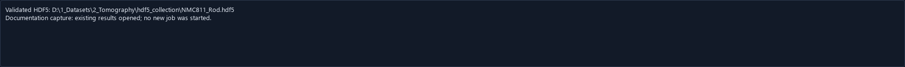

- A new job clears the displayed log; each run keeps its own results and worker records.
- GPU utilization and VRAM describe the selected physical device, including activity from other programs.
- SAM3 GPU inference is only one part of segmentation. CPU mask processing, label creation, compression and disk writes also take time.
- timings.csv separates image reading/normalization, inference, score/NMS, label statistics, TIFF writing, mask packing, NPZ writing and progress/log overhead.
- Use timing_summary.json / analysis_summary.json to distinguish search time from complete-job time.

**Note.** This manual covers released version 1.0.1. Proposed or isolated benchmark optimizations are not described as installed features. Long elapsed times display HH:MM:SS.

## 24. Safe Stop and Partial Results

1. Use Safe Stop on Intelligent Data Analysis, or Safe stop in the manual Current job panel.
2. Wait while the recorded worker and its child reconstruction processes exit.
3. Inspect the final state and Log, and keep useful completed files if needed.
4. When starting a new GUI analysis, select the input/settings again; the GUI creates a new timestamped run.

- Stopping targets this job's processes, not unrelated GPU tasks.
- A stopped or failed run is never labeled All tasks completed.
- The GUI does not offer a one-click Resume Analysis button in this release.
- The same GUI does not run a manual reconstruction and an automatic analysis at the same time.

**Note.** Do not delete an output directory while its worker is still writing. A retained partial reconstruction is useful for diagnosis but must be identified as incomplete.

## 25. Quick Workflow: Manual Reconstruction

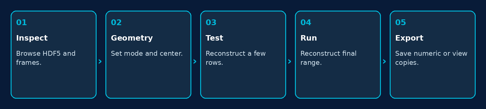

1. Browse HDF5, inspect projections/flat/dark and choose the output parent.
2. Select Tomography or Laminography and a supported method.
3. Set/inspect the center; use manual Find Center / Find Angle when needed.
4. Test a few central detector rows; confirm geometry and image quality.
5. Set the final row range and Run Reconstruction.
6. Inspect slices and export preserve-value TIFF or a separate viewing copy as needed.

## 26. Quick Workflow: Intelligent Analysis

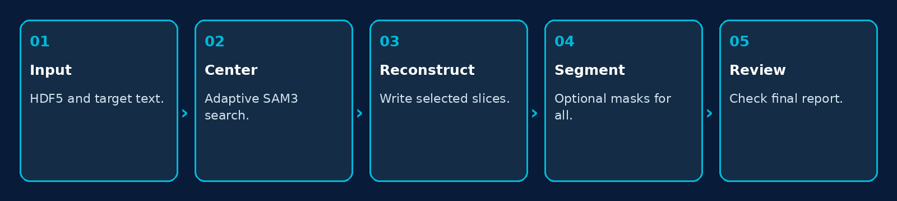

1. Open Intelligent Data Analysis (Test), choose HDF5 and enter particle or another meaningful target.
2. Check Segment All and Settings. Use the global search defaults when no defensible initial range is known.
3. Start Analysis. Inspect the evolving best image and curve.
4. Wait through reconstruction and, if enabled, the explicit segmenting-all-data stage.
5. Check All tasks completed, final counts, selected center and output files.
6. Review masks on representative slices before downstream measurements.

**Note.** A global search can be more expensive than a justified limited range. Disabling Segment All removes full-data segmentation, but center-search SAM3 scoring still runs.

## 27. Updating and Moving the Application

1. Finish or safely stop running jobs and back up result/configuration files.
2. Install the new release, or extract the entire portable folder together.
3. Use Install Environments when the target runtimes do not exist or need preparation.
4. Verify both Python paths, SAM3 repository and checkpoint in Settings.
5. Run a small manual reconstruction and a restricted small automatic analysis before a full production run.

- Keep scientific data and central checkpoints outside the application folder.
- Per-user application settings can differ on another Windows account/computer.
- Updating a checkpoint path/file does not change the model inside a job already running; start a new job to load it.
- Use the selected dataset's geometry; do not reuse a previous specimen's center without checking.

**Note.** The GitHub release and the installer/portable package are application distributions, not datasets or model-weight archives.

## 28. Troubleshooting

| Symptom | Check / action |
| --- | --- |
| HDF5 validation fails | Check exchange datasets, 3D data shape, angle count and finite theta values. |
| Backend cannot start | Verify the native reconstruction Python environment and complete application folder. |
| SAM3 cannot load | Check SAM3p1 Python, repository, compatible inference checkpoint and CUDA. |
| Center estimate is poor | Inspect best reconstruction, prompt, checkpoint and curve; compare nearby centers. A strong model score alone does not prove physical correctness. |
| Find Angle disabled | Select Laminography. Automatic analysis does not search laminography angles. |
| Center value looks scaled | Check original versus effective geometry and binning. Do not divide twice. |
| Reconstruction is complete but job runs | Read Stage 3: full-data segmentation and saving can continue after reconstruction. |
| GPU is quiet during segmentation | CPU mask work, compression or disk I/O may be active; inspect per-step timing. |
| Saved PNG values differ | PNG uses display mapping. Use preserve-value TIFF for quantitative output. |
| Same particle IDs on different slices | IDs are local per slice; no z-tracking is performed. |

**Note.** Include version, input shape, mode/method, binning, center/range, GPU ID, checkpoint and final log lines when reporting a problem.

## 29. Terminology and Output Reference

| Term | Meaning |
| --- | --- |
| Projection | A measured detector frame at one acquisition angle |
| Detector row / slice | A selected detector row used for a reconstructed output slice |
| Rotation center | Axis coordinate along detector columns, in original pixels |
| Binning | Spatial reduction by the selected power-of-two factor |
| Center candidate | One reconstruction evaluated at a particular center |
| Confidence-weighted score | Sum of normalized retained-particle confidences |
| NMS IoU | Overlap threshold for suppressing duplicate predicted masks |
| Safe Stop | Requested cancellation of this job and its child workers |
| Preserve-value TIFF | Numeric image output retaining the selected value representation |
| Instance NPZ | Compressed independent binary masks and scores, including overlaps |

**Note.** For packed masks, read shape=(height,width) and unpack bits along axis 1, truncate to height×width, then reshape to (instances,height,width). The scientific TIFF and viewing PNG serve different purposes.
