# BL62 Reconstruction GUI — User Manual

English edition: November 11, 2026

Application release: 1.3.0

Windows version 1.3.0. Current controls and source were checked on November 11, 2026, including fixed-angle laminography analysis, instance prompting, preprocessing and the optional manual Tofu GPU backend.

## 1. Choose the Workflow

Reconstruction supports manual tomography and laminography. Intelligent Data Analysis (Test) uses a text or instance target to search for a rotation center, reconstruct the selected volume and optionally segment all output slices.

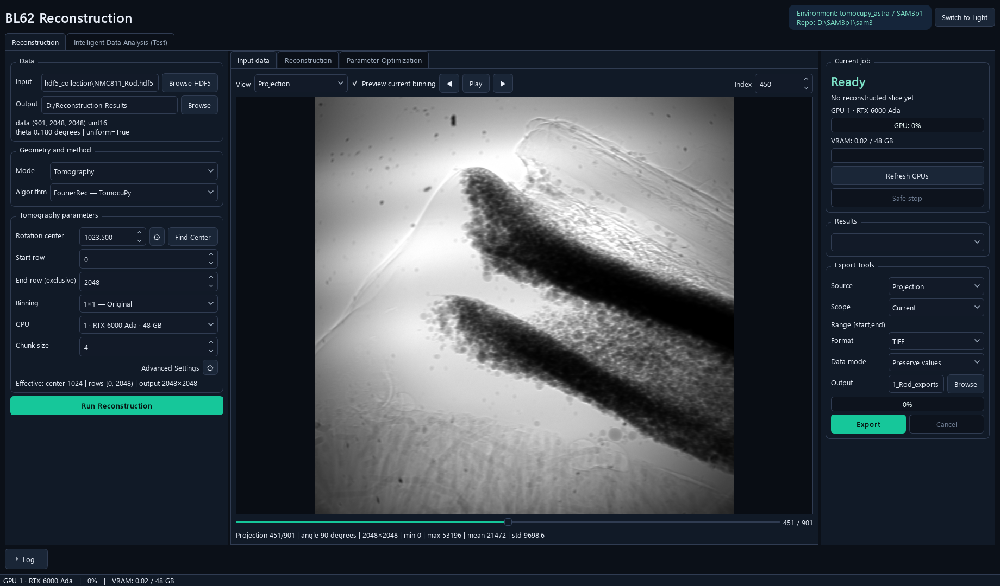

| Task | Start here |
| --- | --- |
| Select a center or tilt visually | Reconstruction → Find Center / Find Angle |
| Reconstruct with a known center and angle | Reconstruction → Run Reconstruction |
| Find a center using a text target | Intelligent Data Analysis (Test) → Text |
| Find a center using a painted example | Intelligent Data Analysis (Test) → Instance |
| Use Tofu/UFO GPU | Reconstruction → Laminography → Tofu/UFO GPU (Experimental) |

## 2. Installation and Shared Workstations

1. Use the complete Windows installer or extract the complete portable folder for release 1.3.0.
2. Prepare the native Windows reconstruction environment with the supplied environment installer. SAM3 analysis also needs its Python environment, repository and inference checkpoint.
3. Launch the application and check the Environment / Repo header. Configure analysis paths under Settings → SAM3.
4. For a shared installation, use the shortcuts created by D:\BL62_Shared\Setup-BL62.cmd while signed in to the intended Windows account.

| Component | Use |
| --- | --- |
| Windows GUI | EXE plus its _internal folder, or the configured source launcher |
| tomocupy_astra | Native TomoCuPy / ASTRA reconstruction and preprocessing |
| SAM3p1 and a compatible checkpoint | Text/instance scoring and optional segmentation |
| BL62-Tofu WSL2 runtime | Optional Tofu/UFO GPU computation for manual laminography |

**Note.** Each account keeps its own settings and output defaults. The shared launcher stores application state under %LOCALAPPDATA%\BL62_UserData. Each Windows account registers its own Tofu WSL runtime once.

## 3. Open Data and Check the Acquisition

1. Click Browse HDF5 and choose an exchange-format .h5 or .hdf5 file.
2. Read the projection count, detector size, data type and angle information in Data.
3. Choose Tomography or Laminography from the known acquisition geometry.
4. Check projection, flat and dark previews. The flat field should match the acquisition and detector conditions.
5. Choose the Output parent folder. Each execution receives a separate run directory.

| HDF5 entry | Content |
| --- | --- |
| /exchange/data | Projection stack, ordered as projection × detector row × detector column |
| /exchange/data_white | Flat-field frames |
| /exchange/data_dark | Dark-field frames |
| /exchange/theta | One finite rotation angle per projection |

**Note.** Both acquisition geometries can contain theta. Use the acquisition geometry to choose the mode. Loading another input refreshes the suggested center, middle trial row and full reconstruction range.

## 4. Preview Data, GPU and Color Theme

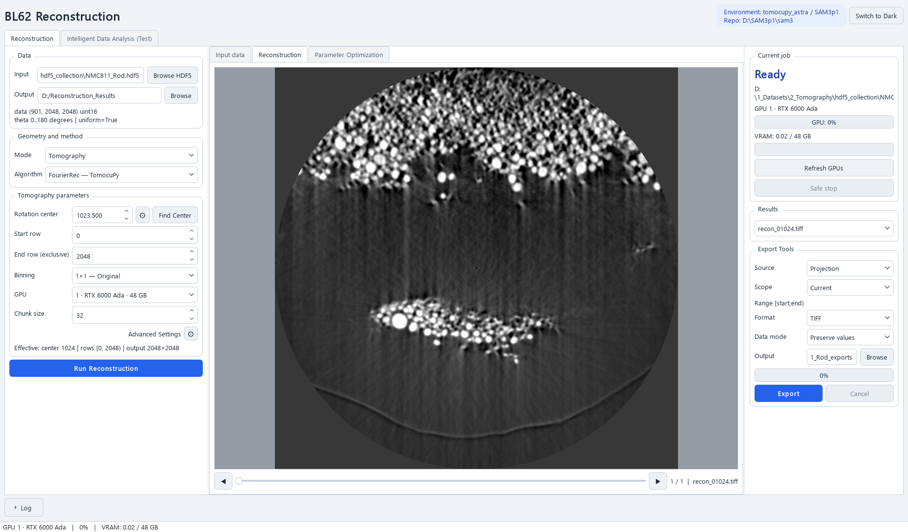

1. In Input Data, choose Projection, Flat, Dark, Flat/Dark Corrected or -Log Attenuation.
2. Use the arrows, slider, Index or Play to browse frames. Preview current binning follows the selected binning.
3. Choose a GPU in the left parameter panel. Read utilization and memory for that selected device on the right.
4. Use the top-right theme button. Its label names the theme it will switch to.
5. Expand Log when detailed worker output is needed.

**Note.** Frame Index selects an acquired projection or calibration frame. Reconstruction Start/End Row select output planes. Display contrast is a viewing transform.

## 5. Coordinates, Ranges and Binning

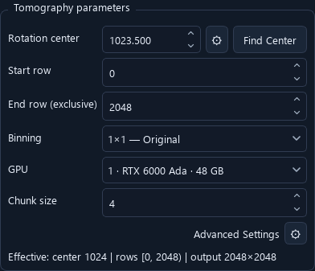

| Control | Meaning |
| --- | --- |
| Rotation center | Original detector-pixel axis coordinate |
| Try detector row | Detector row used for candidate reconstructions |
| Start row / End row (exclusive) | Reconstruction output interval [start, end) |
| Binning | 1×1, 2×2, 4×4 or 8×8 spatial reduction |
| Chunk size | Backend batch size. LineRec requires at least 4. |
| Iterations | Iteration count for SIRT_CUDA and CGLS_CUDA |

**Note.** Keep entered centers and row coordinates in the original units. The GUI converts them for binning. In laminography, complete output height can exceed detector height. The GUI updates full-range limits when mode, tilt or binning changes. Read Effective geometry before running.

## 6. Tomography Algorithms

- For a method comparison, keep input, center, rows, binning, preprocessing and applicable filter equal.
- LpRec uses a lightweight linked view with uniform angles after the approximation is accepted. The run metadata records that choice.
- Inspect several reconstructed slices when choosing a method and its settings.

| Algorithm | Type | Control to check |
| --- | --- | --- |
| FourierRec — TomoCuPy | Fourier-based analytic reconstruction | Center, angle coverage and filter |
| LpRec — TomoCuPy | Log-polar analytic reconstruction | Explicit uniform-angle approximation |
| LineRec — TomoCuPy | Direct filtered backprojection | Chunk size of at least 4 |
| FBP_CUDA — ASTRA | Analytic GPU backprojection | Filter and geometry |
| SIRT_CUDA — ASTRA | Iterative reconstruction | Iterations and convergence |
| CGLS_CUDA — ASTRA | Iterative least-squares reconstruction | Iterations and noise sensitivity |

**Note.** The six methods in this table use parallel-beam tomography geometry. Select Laminography to access its separate algorithm list.

## 7. Manual Rotation-Center Candidates

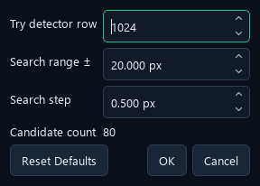

1. Set an initial Rotation center.
2. Open its gear and set Try detector row, Search range ± and Search step.
3. Click Find Center. Candidates are written to an isolated run directory.
4. Compare the candidate images under Parameter Optimization.
5. Choose the preferred candidate and click Apply Parameter. The center is copied into Reconstruction parameters and saved with the candidate source.
6. Run Reconstruction with the selected value.

**Note.** The saved sweep includes an upper endpoint that falls on the requested grid. For example, center 1070.5 ±1 px at 0.25 px gives 9 candidates. The dialog Candidate count is a preview estimate. Read the generated files and job progress for the actual count. Tomography trials use the selected TomoCuPy method, with FourierRec used for an ASTRA selection.

## 8. Apply a Candidate in Parameter Optimization

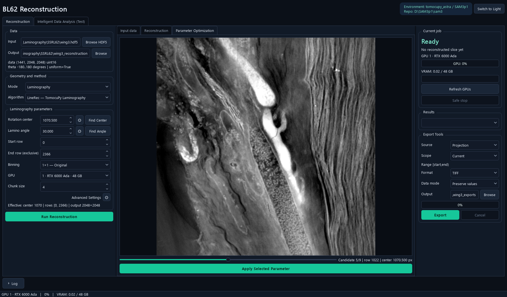

1. Move the candidate slider and read the displayed center in pixels or angle in degrees.
2. Inspect the same structures in neighboring candidates.
3. Click Apply Parameter for the chosen image.
4. Review Rotation center or Lamino angle in the left panel before starting the final run.

| Candidate kind | Saved selection |
| --- | --- |
| Rotation center | selected_rotation_center.json |
| Laminography tilt | selected_lamino_angle.json |

## 9. Laminography and Manual Angle Candidates

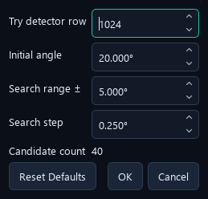

1. Select Laminography, then choose FourierRec, LineRec or Tofu/UFO GPU (Experimental) for reconstruction.
2. Enter the signed Lamino angle in the acquisition convention and set the rotation center.
3. To compare angles, open the angle gear and choose Try detector row, Initial angle, Search range ± and Search step.
4. Click Find Angle, browse Parameter Optimization and use Apply Parameter on the preferred angle.
5. Check the full output-row range after changing the angle, then Run Reconstruction.

**Note.** TomoCuPy laminography center/angle trials use LineRec. Selecting Tofu routes both kinds of manual trial to Tofu. Positive and negative tilts describe different geometry. Automatic analysis searches the center at a fixed entered angle.

## 10. Advanced Settings and Calibration

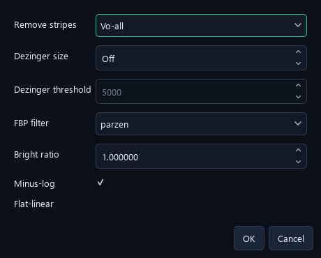

| Field | Factory default | Use |
| --- | --- | --- |
| Remove stripes | Vo-all | Alternatives are None, Fourier-wavelet and Titarenko. |
| Dezinger size | Off | Set a size, such as 5, when spike removal is required. |
| Dezinger threshold | 5000 | Active when Dezinger size is greater than zero. |
| FBP filter | parzen | Analytic reconstruction filter |
| Bright ratio | 1.0 | Flat exposure divided by projection exposure |
| Minus-log | Enabled | Convert transmission to attenuation |
| Flat-linear | Disabled | Interpolate flats when an appropriate series is available. |

**Note.** Open the gear beside Advanced Settings in the manual panel, or Settings → Advanced Settings in analysis. Saved user preferences can differ from factory defaults. Verify the correct flat/dark data before interpreting a ring or boundary artifact.

## 11. Run Reconstruction and Browse the Output

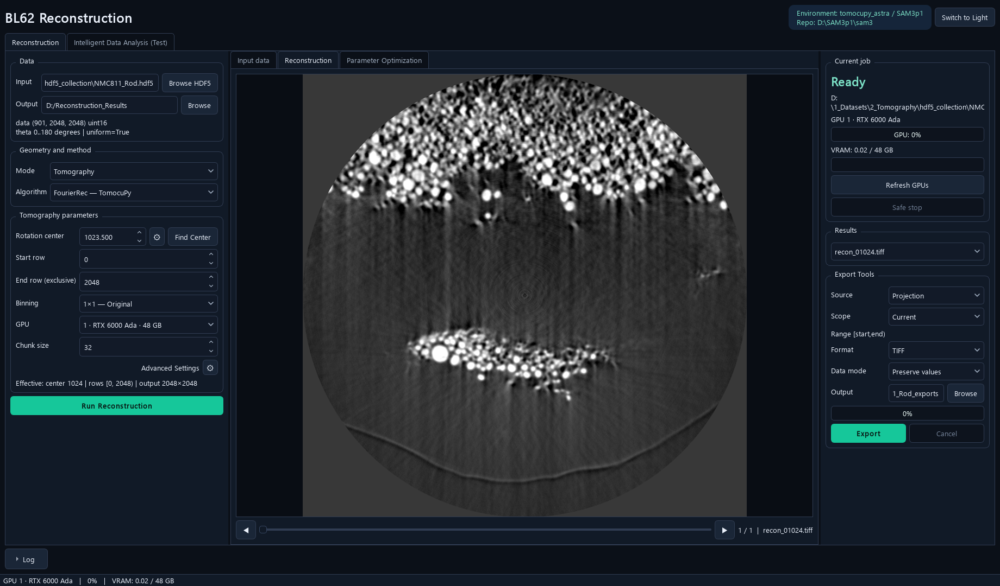

1. Confirm the input, output parent, mode, method, center, signed tilt when applicable, rows, binning and GPU.
2. Click Run Reconstruction and read the current task on the right.
3. Browse saved slices with the reconstruction file list and slider as they become available.
4. Use Open Output to inspect the run folder.
5. Use Safe Stop to end the current job and wait for worker cleanup.

**Note.** Completed TIFFs remain available after Safe Stop. Check final status and the recorded output count when distinguishing a complete volume from a stopped run. The Log starts collapsed and can be expanded for backend details.

## 12. Tofu/UFO GPU Setup and Use

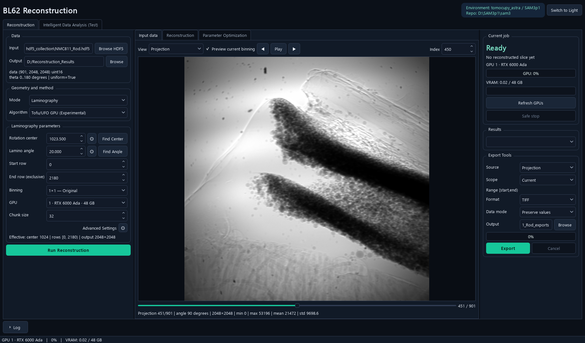

1. Enable WSL2 on Windows and install an NVIDIA driver with WSL GPU support.
2. Place BL62-Tofu-GPU-1.0.0.tar.gz and its .sha256 file in D:\BL62_Runtime\Tofu.
3. Select Tofu/UFO GPU (Experimental) for a manual Laminography task. First use can run the supplied setup_tofu_runtime.ps1 automatically.
4. Allow checksum verification, account-local runtime import and the offline GPU self-check to finish.
5. Use Find Center, Find Angle, Apply Parameter and Run Reconstruction with the usual original-pixel coordinates and signed tilt.
6. Read progress during preprocessing, staging, GPU reconstruction and saving.

**Note.** The runtime distribution is BL62-Tofu. Each Windows account registers it separately while sharing the archive. Runtime configuration is under %APPDATA%\BL62_Reconstruction\tofu_runtime.json. Its virtual disk is placed on D: when available. The effective detector requires even width of at least 32 and height of at least 16. Tofu is available in manual Laminography.

## 13. Intelligent Analysis with a Text Target

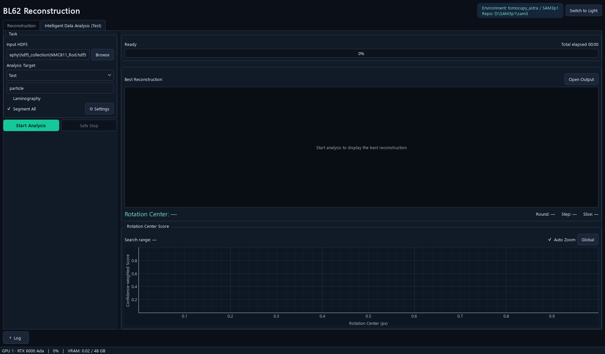

1. Open Intelligent Data Analysis (Test) and choose the input HDF5.
2. Choose Text and enter a structure target, such as particle.
3. For a laminography acquisition, check Laminography and enter its signed tilt. Cancelling the angle dialog clears the checkbox.
4. Leave Segment All checked for masks on every reconstructed output slice.
5. Review Settings as needed, then click Start Analysis.

**Note.** The angle stays fixed during automatic center search. Tomography remains selected when Laminography is unchecked. The analysis target and geometry are recorded with each job. The default output is a timestamped analysis directory beside the input.

## 14. Paint and Reuse an Instance Example

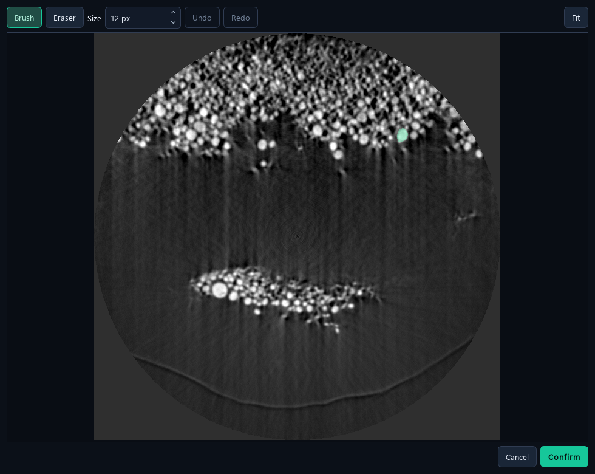

1. Choose Instance in Analysis Target, then click Add Image.
2. Choose a reference image. It can be a different image from the target reconstructions.
3. Paint one representative feature with Brush. Remove unwanted pixels or an interior hole with Eraser.
4. Use Undo / Redo to correct the example, then Confirm.
5. Check the cropped feature outline below Add Image, choose Segment All as needed and Start Analysis.

| Control | Action |
| --- | --- |
| B / E | Brush / Eraser |
| Ctrl+Z | Undo |
| Ctrl+Y or Ctrl+Shift+Z | Redo |
| Mouse wheel / middle drag | Zoom / pan |
| Fit | Fit reference image |
| Cancel | Keep the previous confirmed example |

**Note.** A nonempty example is required. Brush size uses image pixels. The current adapter isolates the painted feature, including erased holes, before extracting visual reference tokens. The reference is saved with the job and reused for its candidates and optional full-data segmentation.

## 15. Confirm the Instance Preview

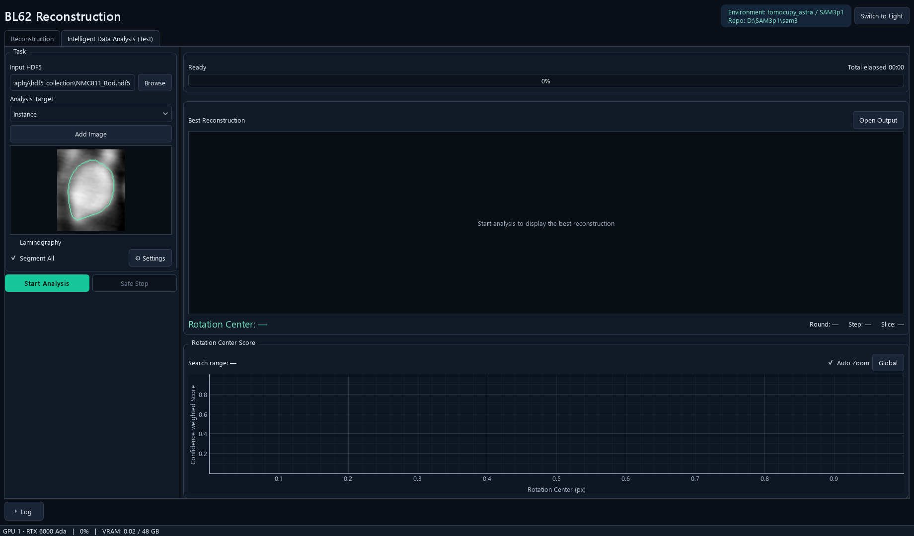

- The confirmed example stays fixed during a running analysis.
- Use Add Image again to choose and confirm a replacement example.
- The saved instance_reference directory contains reference.png, mask.png, preview.png, isolated_reference.png, example.json and encoding.json.
- Example identity and asset hashes are included in the job records.

**Note.** The painted reference supplies model evidence for similar targets. Inspect the chosen reconstruction and masks when evaluating its transfer to a new material or feature.

## 16. Analysis Settings for Reconstruction and Search

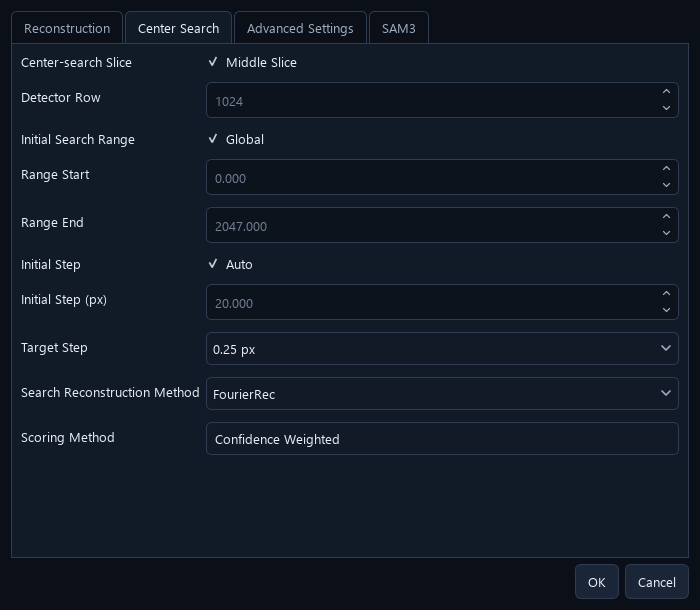

| Setting | Meaning |
| --- | --- |
| Output Location | Input Folder or Custom Folder parent, with a new timestamped child per run |
| Reconstruction Method / GPU | Final method and selected physical GPU |
| All Slices | Complete output range for the selected geometry |
| Middle Slice | Detector row floor(height/2), for example 1024 of 2048 |
| Global | Centers from 0 through detector width minus one |
| Auto initial step | Width divided by 100, rounded to an integer with a minimum of 1 |
| Target Step | 0.25, 0.5 or 1 original pixel |
| Search Reconstruction Method | FourierRec or LineRec for tomography candidates |

**Note.** For fixed-angle laminography analysis, candidates use laminography LineRec. The final method is laminography FourierRec or LineRec. A tomography-only final selection is mapped to laminography LineRec. Tofu is selected in the manual workspace.

## 17. Analysis Settings for SAM3 and Scoring

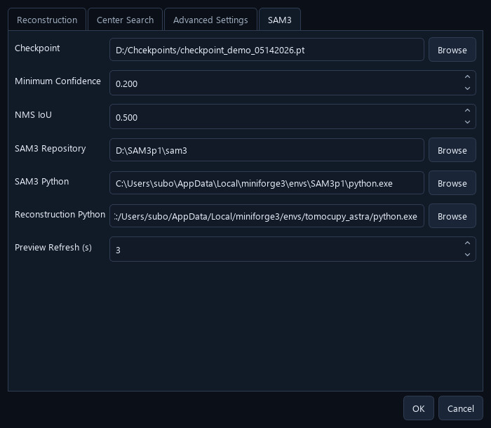

| Setting | Default or purpose |
| --- | --- |
| Checkpoint | D:\Chcekpoints\checkpoint_demo_05142026.pt |
| Minimum Confidence | 0.20 |
| NMS IoU | 0.50 duplicate-mask threshold |
| SAM3 Repository / Python | Compatible native Windows source and inference environment |
| Reconstruction Python | Native Windows reconstruction environment |
| Preview Refresh | 3 seconds |

```text
Instance reward = clip((confidence - 0.20) / 0.60, 0, 1)
Candidate score = sum of rewards after duplicate removal

Confidence 0.60 contributes 0.6667.
Confidence 0.80 or above contributes 1.0.
```

**Note.** The analysis loads its own model once and releases it at worker exit. Higher score indicates stronger combined model evidence. Compare candidate images when interpreting a broad or multi-peak curve. Target Step describes grid spacing.

## 18. Progress, Curves and Completion

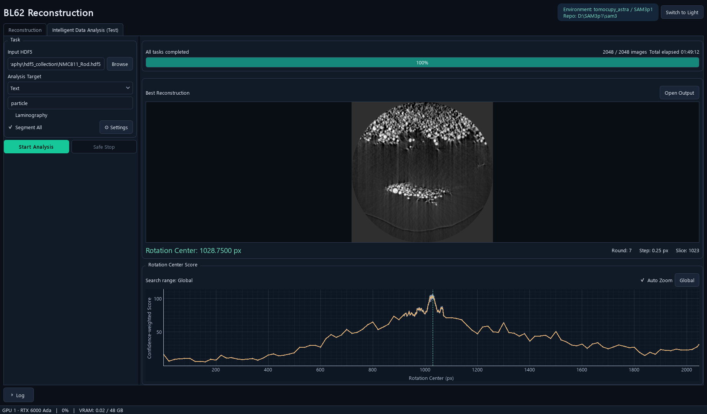

- Best Reconstruction and Rotation Center update together from the current worker status.
- Auto Zoom follows the current search range. Global displays the accumulated full-range curve.
- Every search round smooths the accumulated scores globally, including earlier rounds.
- Read per-stage counts and total elapsed time. A center-search result can be available while later stages are still running.

| Displayed stage | Work in progress |
| --- | --- |
| Finding Rotation Center | Candidate reconstruction, target recognition, score calculation and refinement |
| Reconstructing all data | Writing the requested numeric volume |
| Reconstruction completed — segmenting all data | Recognition, de-duplication, label generation and saving for the whole volume |
| Saving / Finalizing | Writing final reports |
| Completed | The worker has reported successful completion |

## 19. Output Files and Image Export

1. In Export Tools, choose the source and Current, Range or All.
2. Set the end-exclusive range when Range is selected.
3. Choose TIFF with Preserve values or Float32 for numeric downstream processing.
4. Choose Display 8-bit / 16-bit for a viewing copy. PNG uses a display mapping.
5. Choose an export folder and click Export.

| Output | Use |
| --- | --- |
| analysis_job.json / pipeline_config.json | Submitted settings and runtime configuration |
| status.json / analysis_summary.json | Live/final status and completed-run summary |
| center_search/ | Scores, search history, best image and selected center |
| instance_reference/ | Saved example when Instance mode is used |
| reconstruction/ | Numeric reconstructed TIFFs |
| segmentation/ | Per-slice labels, packed instance masks and instance statistics when Segment All is enabled |

**Note.** The export metadata records dimensions, data type and viewing conversion. In analysis segmentation, instance_id is local to a slice. Cross-slice particle identity requires the separate association workflow.

## 20. Troubleshooting, Updates and Checkpoints

1. Save the relevant settings and note the input, geometry, model and software version when reporting an issue.
2. Use Safe Stop and wait for worker exit before replacing application files.
3. Install or extract the complete new release, and check its version and configured paths.
4. Keep centrally managed checkpoints versioned. Start a new analysis after updating the selected model file.

| Symptom | Check |
| --- | --- |
| Large ring or unexpected structure | Flat/dark calibration, signed tilt, center and acquisition geometry |
| Partial laminography height | Current End row and Effective geometry after choosing angle and binning |
| Tofu runtime unavailable | Archive plus checksum, WSL2, NVIDIA driver and current-account runtime registration |
| CUDA memory error | Selected GPU, concurrent jobs, binning and chunk size |
| Center curve is weak or ambiguous | Target/example, checkpoint, confidence and reconstructed candidate images |
| Job continues after reconstruction | Current segmentation and saving stage |
| Blank or old result during navigation | Current selected file, completed output availability and final Log |
| Different account cannot use a path | That account’s dataset, checkpoint, environment and output access |

**Note.** The current Tofu validation includes a complete binned volume and a restricted original-resolution interval. Whole-volume timing depends on input reading, preprocessing, temporary staging, GPU reconstruction and output writing.

